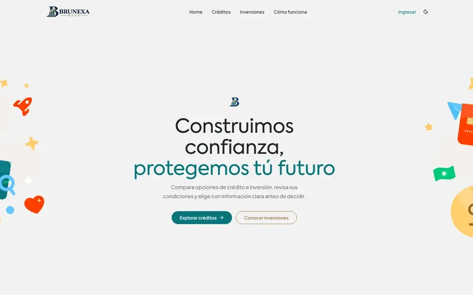
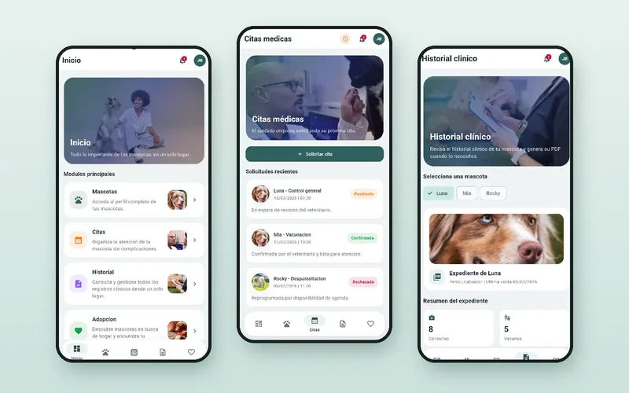
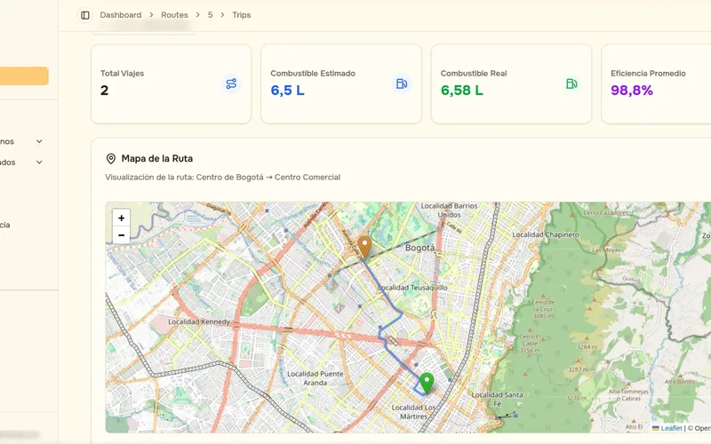
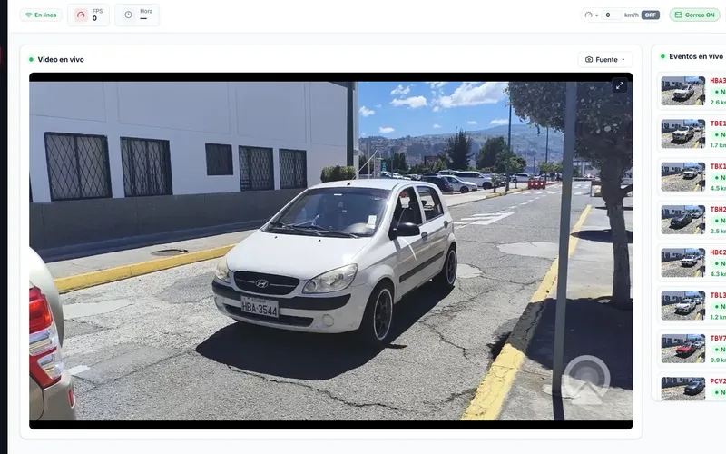
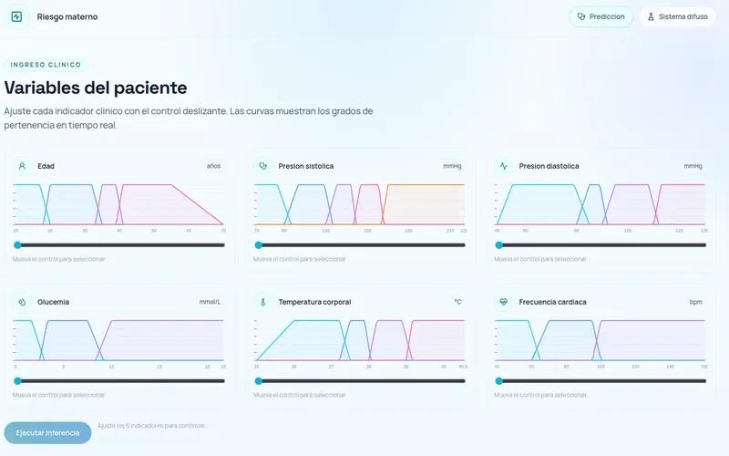
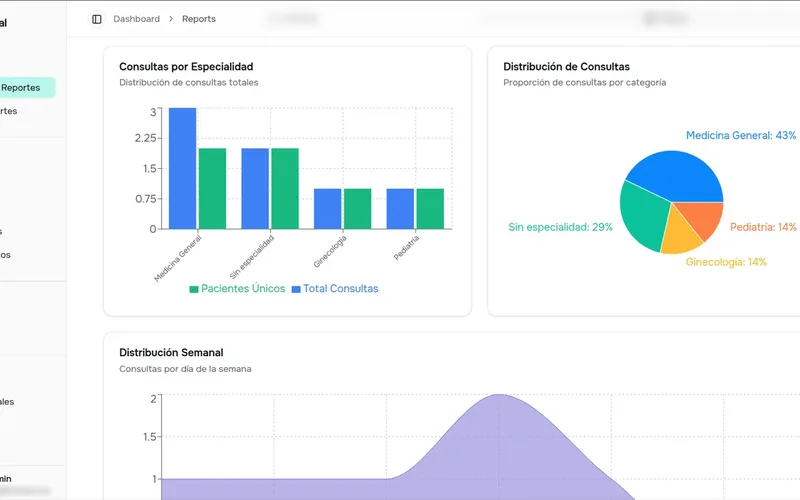
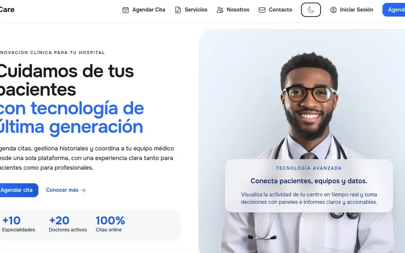
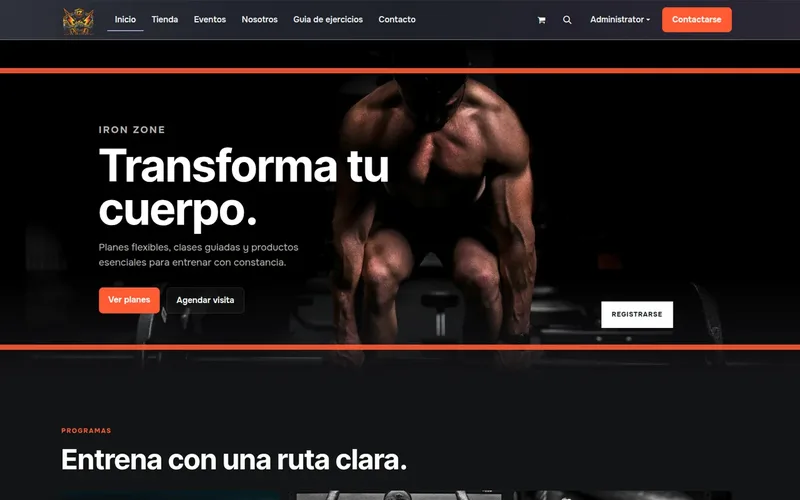

<picture>
  <source media="(prefers-color-scheme: dark)" srcset="assets/banner-es-dark.svg" />
  <source media="(prefers-color-scheme: light)" srcset="assets/banner-es-light.svg" />
  
</picture>

[English](README.md) · **Español**

**Construyo soluciones de software de punta a punta:** entiendo el problema, diseño la base de datos y la API, y entrego la interfaz que la gente usa.

Desarrollador full stack y estudiante de último año de Ingeniería en Software en la Universidad Técnica de Ambato (Ecuador), con un año de experiencia laboral en desarrollo, soporte de sistemas y datos.

Ambato, Ecuador · 1 año de experiencia laboral · Disponible para trabajo remoto o presencial

### Qué hago

<table>
<tr>
<td width="33%" valign="top"><b>Backend</b> APIs y servicios que se comunican entre sí, con seguridad por roles y pruebas automatizadas.</td>
<td width="33%" valign="top"><b>Frontend y móvil</b> Interfaces web y apps móviles claras, conectadas en tiempo real con el backend.</td>
<td width="33%" valign="top"><b>Datos</b> Bases de datos bien modeladas, reportes e indicadores para decidir con datos.</td>
</tr>
</table>

### Experiencia

**Analista de Datos y BI · Kronhos** (Ene – Jun 2026)  
Reportes para más de 5 empresas clientes de un ERP comercial; optimicé las consultas detrás de ellos y reduje su tiempo en un <b>60 %</b> en promedio.

**Desarrollador y soporte de sistemas · Vaz Sport** (Jul – Dic 2025)  
Desarrollé el sistema de gestión de producción con el que la empresa coordina sus áreas productivas; administré servidores, respaldos, usuarios y accesos.

### Proyectos destacados

<table>
<tr>
<td width="50%" valign="top">

<h3>Brunexa, banca en línea</h3>
Banca en línea con simuladores de crédito e inversión y registro con verificación de identidad. <b>Mi parte:</b> Construí el módulo completo de inversiones: tasas por monto y plazo, impuestos, simulación por meta y reporte en PDF.
  <code>Java · Spring Boot · React · TypeScript</code> 
<a href="https://github.com/DavidJosueP2/Banking-Credit-Investment-Simulator">Código</a>
</td>
<td width="50%" valign="top">

<h3>PetSafe, gestión veterinaria</h3>
Plataforma web y móvil para una clínica veterinaria: citas, cola de atención y notificaciones. <b>Mi parte:</b> Desarrollé la app móvil, las notificaciones push, el código QR por mascota y la cola de atención.
  <code>Flutter · NestJS · Angular · PostgreSQL</code> 
<a href="https://github.com/JoelBonillaG/petsafe_movil_app">Código</a>
</td>
</tr>
<tr>
<td width="50%" valign="top">

<h3>Gestión distribuida de combustible</h3>
Compara el consumo real de combustible de cada viaje con el esperado. <b>Mi parte:</b> Desarrollé los microservicios de usuarios y de rutas y viajes, y sus pantallas. Equipo de 4.
  <code>NestJS · gRPC · RabbitMQ · PostgreSQL</code> 
<a href="https://github.com/DavidJosueP2/Distributed-Gasoline-System">Código</a>
</td>
<td width="50%" valign="top">

<h3>Lectura automática de placas · <i>Artículo publicado</i></h3>
Detecta vehículos con una cámara, lee su placa y sugiere una sanción explicable. <b>Mi parte:</b> Entrené los modelos que leen cada carácter y diseñé las reglas de sanción. <b>94.59 %</b> de placas leídas completas en 74 vehículos reales.
  <code>Python · PyTorch · OpenCV · FastAPI · React</code> 
<a href="https://github.com/JoelBonillaG/Plate_Detection_Segmentation_OCR">Código</a> · <a href="https://doi.org/10.63957/arksis.v1i2.0011">Artículo</a>
</td>
</tr>
<tr>
<td width="50%" valign="top">

<h3>Evaluación de riesgo materno · <i>Artículo en revisión</i></h3>
Clasifica el riesgo de un embarazo a partir de signos vitales y explica cada resultado. <b>Mi parte:</b> Construí el motor difuso y el algoritmo genético que aprende sus reglas: <b>159</b> de 8 640 posibles.
  <code>Python · FastAPI · React · TypeScript</code> 
<a href="https://github.com/JoelBonillaG/Fuzzy-Genetic-Maternal-Risk-Assessment">Código</a>
</td>
<td width="50%" valign="top">

<h3>Gestión hospitalaria</h3>
Plataforma de microservicios para gestionar pacientes y consultas médicas. <b>Mi parte:</b> Construí el microservicio de consultas y el módulo de pacientes. Equipo de 4.
  <code>Java · Spring Cloud · Eureka · React</code> 
<a href="https://github.com/JosueGarciaAbata/hospital-management-system">Código</a>
</td>
</tr>
<tr>
<td width="50%" valign="top">

<h3>ClinicCare, citas médicas</h3>
Plataforma clínica para agendar citas y gestionar usuarios con acceso seguro.
  <code>Spring Boot · Java 21 · React · PostgreSQL</code> 
<a href="https://github.com/DRTX2/clinic">Código</a>
</td>
<td width="50%" valign="top">

<h3>Iron Zone, gestión de gimnasio</h3>
Plataforma de gimnasio que reúne sitio web, membresías y facturación en un solo sistema.
  <code>Odoo 18 · Python · PostgreSQL · Docker</code> 
<a href="https://github.com/JoelBonillaG/iron_zone_odoo_das">Código</a>
</td>
</tr>
</table>

Más proyectos y casos de estudio en mi [portafolio](https://portfolio-nu-two-64bxitcr17.vercel.app/).

### Publicaciones

**Vehicle monitoring system for automobiles through license plate character recognition and sanction assessment using Mamdani fuzzy** 
J. García-Abata, **F. Bonilla-Guerrero**, R. Nogales · *ARKSIS Journal*, vol. 1, no. 2, 2026 · DOI [10.63957/arksis.v1i2.0011](https://doi.org/10.63957/arksis.v1i2.0011)

### Tecnologías

<table>
<tr><td><b>Lenguajes</b></td><td>      </td></tr>
<tr><td><b>Backend</b></td><td>     </td></tr>
<tr><td><b>Frontend y móvil</b></td><td>   </td></tr>
<tr><td><b>Datos</b></td><td>   </td></tr>
<tr><td><b>Calidad y entrega</b></td><td>     </td></tr>
<tr><td><b>Metodologías</b></td><td> </td></tr>
</table>

### Ahora

`Nov 2026` · Profundizando en arquitectura backend y pruebas; construyendo un proyecto full stack individual de punta a punta.

 
<picture>
  <source media="(prefers-color-scheme: dark)" srcset="https://raw.githubusercontent.com/JoelBonillaG/joelbonillag/output/github-snake-gold.svg" />
  <source media="(prefers-color-scheme: light)" srcset="https://raw.githubusercontent.com/JoelBonillaG/joelbonillag/output/github-snake.svg" />
  
</picture>

### Contacto

  

**CV:** [Español](assets/cv/Joel-Bonilla-CV.pdf) · [English](assets/cv/Joel-Bonilla-CV-EN.pdf)

<!-- Owner: Joel Bonilla. Last reviewed: 2026-11-22.
     Review when: a new job or role, a new featured project, a new paper, graduation, or a job search starts. -->
