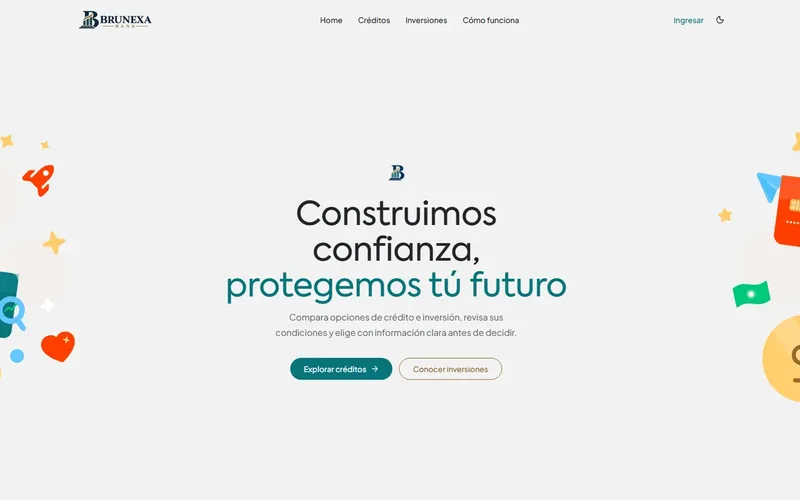
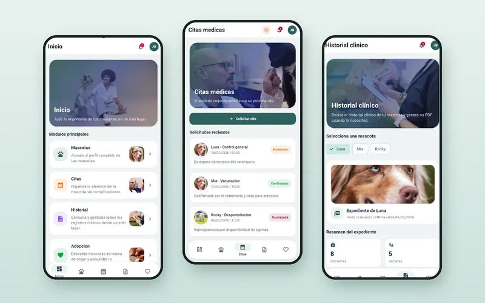
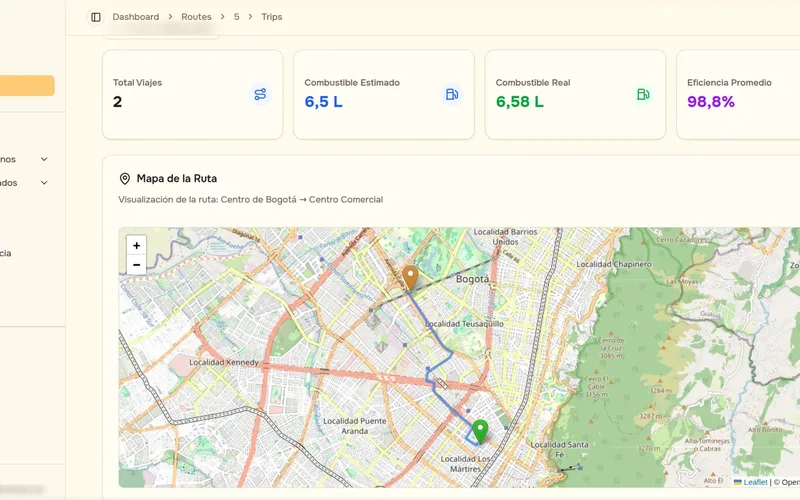
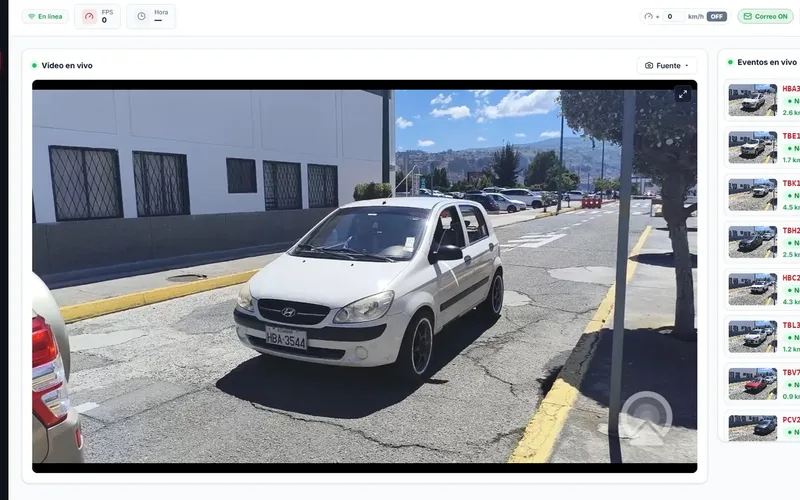
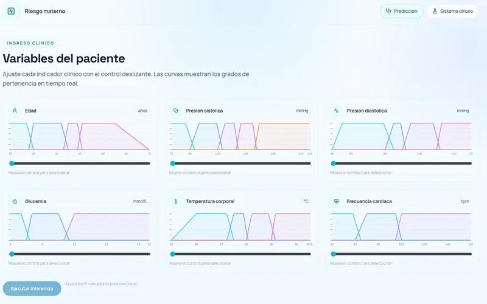
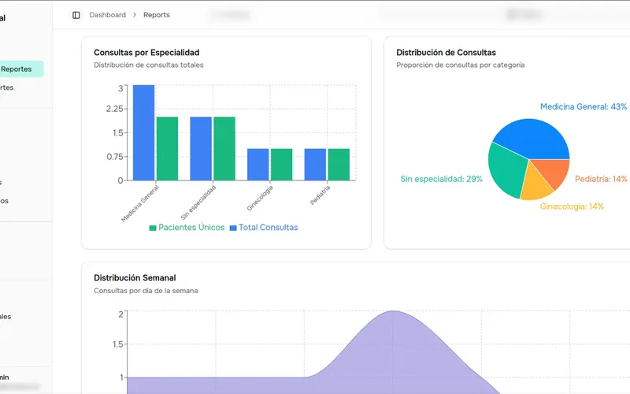
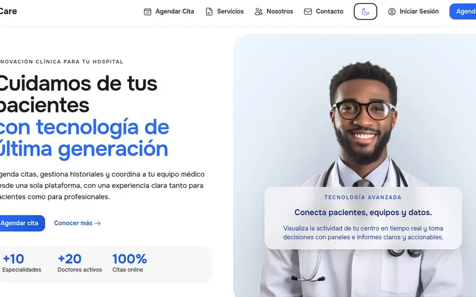
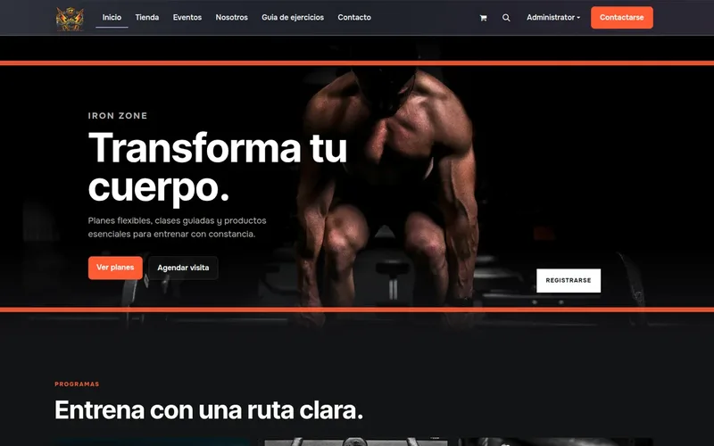

<picture>
  <source media="(prefers-color-scheme: dark)" srcset="assets/banner-en-dark.svg" />
  <source media="(prefers-color-scheme: light)" srcset="assets/banner-en-light.svg" />
  
</picture>

**English** · [Español](README.es.md)

**I build software end to end:** I understand the problem, design the database and the API, and ship the interface people actually use.

Full stack developer and final-year Software Engineering student at Universidad Técnica de Ambato (Ecuador), with one year of work experience in development, systems support and data.

Ambato, Ecuador · 1 year of work experience · Open to remote or on-site roles

### What I do

<table>
<tr>
<td width="33%" valign="top"><b>Backend</b> APIs and services that talk to each other, with role-based security and automated tests.</td>
<td width="33%" valign="top"><b>Frontend &amp; mobile</b> Clear web interfaces and mobile apps, connected to the backend in real time.</td>
<td width="33%" valign="top"><b>Data</b> Well-modelled databases, reports and KPIs so teams decide with data.</td>
</tr>
</table>

### Experience

**Data &amp; BI Analyst · Kronhos** (Jan – Jun 2026)  
Reports for 5+ client companies of a commercial ERP; optimized the queries behind them and cut their run time by <b>60%</b> on average.

**Developer &amp; systems support · Vaz Sport** (Jul – Dec 2025)  
Built the production management system the company uses to coordinate its production areas; managed servers, backups, users and access.

### Featured projects

<table>
<tr>
<td width="50%" valign="top">

<h3>Brunexa: online banking</h3>
Online banking with credit and investment simulators and identity-verified sign-up. <b>My part:</b> Built the whole investment module: rates by amount and term, taxes, goal simulation and PDF report.
  <code>Java · Spring Boot · React · TypeScript</code> 
<a href="https://github.com/DavidJosueP2/Banking-Credit-Investment-Simulator">Code</a>
</td>
<td width="50%" valign="top">

<h3>PetSafe: web and mobile vet clinic</h3>
Web and mobile platform for a vet clinic: appointments, queue and notifications. <b>My part:</b> Built the mobile app, push notifications, pet QR codes and the care queue.
  <code>Flutter · NestJS · Angular · PostgreSQL</code> 
Code: <a href="https://github.com/JoelBonillaG/petsafe_movil_app">Mobile app</a> · <a href="https://github.com/STRATIUM-UTA/PetSafe-Back">Backend</a> · <a href="https://github.com/STRATIUM-UTA/PetSafe-Front">Web</a>
</td>
</tr>
<tr>
<td width="50%" valign="top">

<h3>FuelQ: smart fuel control</h3>
Compares each trip's real fuel use with the expected one. <b>My part:</b> Built the users and routes &amp; trips microservices and their screens. Team of 4.
  <code>NestJS · gRPC · RabbitMQ · PostgreSQL</code> 
<a href="https://github.com/DavidJosueP2/Distributed-Gasoline-System">Code</a>
</td>
<td width="50%" valign="top">

<h3>Monitoreo UTA: AI license plate reading · <i>Published paper</i></h3>
Detects vehicles with a camera, reads the plate and proposes an explainable sanction. <b>My part:</b> Trained the models that read each character and designed the sanction rules. <b>94.59%</b> of plates read in full on 74 real vehicles.
  <code>Python · PyTorch · OpenCV · FastAPI · React</code> 
<a href="https://github.com/JoelBonillaG/Plate_Detection_Segmentation_OCR">Code</a> · <a href="https://doi.org/10.63957/arksis.v1i2.0011">Paper</a>
</td>
</tr>
<tr>
<td width="50%" valign="top">

<h3>Maternal risk: explainable AI for pregnancy · <i>Paper under review</i></h3>
Classifies pregnancy risk from vital signs and explains every result. <b>My part:</b> Built the fuzzy engine and the genetic algorithm that learns its rules: <b>159</b> rules out of 8,640.
  <code>Python · FastAPI · React · TypeScript</code> 
<a href="https://github.com/JoelBonillaG/Fuzzy-Genetic-Maternal-Risk-Assessment">Code</a>
</td>
<td width="50%" valign="top">

<h3>H&Q Hospital: hospital management</h3>
Microservices platform to manage patients and medical consultations. <b>My part:</b> Built the consultations microservice and the patients module. Team of 4.
  <code>Java · Spring Cloud · Eureka · React</code> 
<a href="https://github.com/JosueGarciaAbata/hospital-management-system">Code</a>
</td>
</tr>
<tr>
<td width="50%" valign="top">

<h3>ClinicCare: online medical scheduling</h3>
Clinic platform to book appointments and manage users with secure access.
  <code>Spring Boot · Java 21 · React · PostgreSQL</code> 
<a href="https://github.com/DRTX2/clinic">Code</a>
</td>
<td width="50%" valign="top">

<h3>Iron Zone: gym management</h3>
Gym platform that brings website, memberships and invoicing into one system.
  <code>Odoo 18 · Python · PostgreSQL · Docker</code> 
<a href="https://github.com/JoelBonillaG/iron_zone_odoo_das">Code</a>
</td>
</tr>
</table>

More projects and case studies on my [portfolio](https://portfolio-nu-two-64bxitcr17.vercel.app/).

### Publications

**Vehicle monitoring system for automobiles through license plate character recognition and sanction assessment using Mamdani fuzzy** 
J. García-Abata, **F. Bonilla-Guerrero**, R. Nogales · *ARKSIS Journal*, vol. 1, no. 2, 2026 · DOI [10.63957/arksis.v1i2.0011](https://doi.org/10.63957/arksis.v1i2.0011)

### Stack

<table>
<tr><td><b>Languages</b></td><td>      </td></tr>
<tr><td><b>Backend</b></td><td>     </td></tr>
<tr><td><b>Frontend &amp; mobile</b></td><td>   </td></tr>
<tr><td><b>Data</b></td><td>   </td></tr>
<tr><td><b>Quality &amp; delivery</b></td><td>     </td></tr>
<tr><td><b>Methodologies</b></td><td> </td></tr>
</table>

### Now

`Nov 2026` · Deepening backend architecture and testing; building a solo full stack project end to end.

 
<picture>
  <source media="(prefers-color-scheme: dark)" srcset="https://raw.githubusercontent.com/JoelBonillaG/joelbonillag/output/github-snake-gold.svg" />
  <source media="(prefers-color-scheme: light)" srcset="https://raw.githubusercontent.com/JoelBonillaG/joelbonillag/output/github-snake.svg" />
  
</picture>

### Contact

  

**Résumé:** [Spanish](assets/cv/Joel-Bonilla-CV.pdf) · [English](assets/cv/Joel-Bonilla-CV-EN.pdf)

<!-- Owner: Joel Bonilla. Last reviewed: 2026-11-22.
     Review when: a new job or role, a new featured project, a new paper, graduation, or a job search starts. -->
